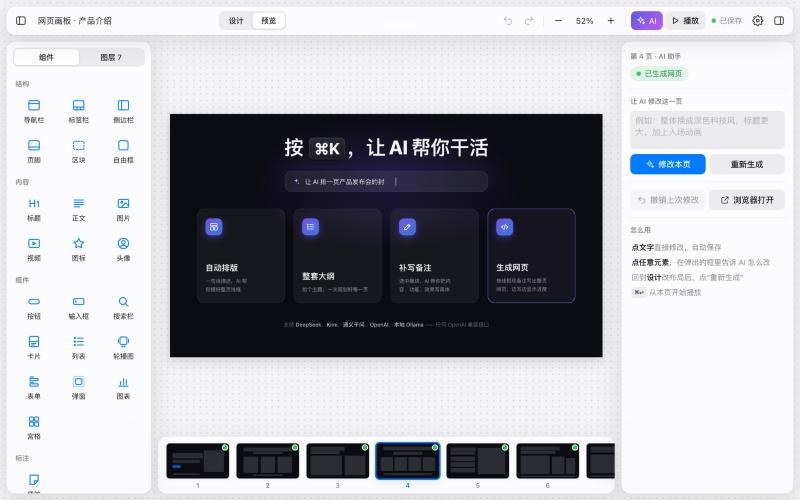

# 网页画板 · HTML Sketchboard

> 用“摆家具”的方式设计网页和 HTML 演示稿：拖模块、写需求，再交给 AI 做成真正的网页。

网页画板是一个**本地运行、零依赖**的线框画板，专门用来**给 AI 讲清楚你想要什么**。

你在画布上摆好导航栏、标题、卡片、按钮这些模块，给每个模块写上“内容 / 功能 / 效果”。之后有两种做法：

- **接入一个大模型**（DeepSeek、Kimi、通义千问、OpenAI 等兼容接口），在画板里一键生成网页，然后直接点文字修改，或者选中元素让 AI 改。
- **交给 AI 编程助手**（Claude Code、Cursor 等）：画板自动保存成结构化的 `board.json`，助手直接读取，按你的布局和备注把网页做出来。

它也是一个**可以替代 PPT 的工具**：支持多页面，播放时点击或按方向键翻页。

## 看看效果

**1 分半教程视频**：从新建项目、摆模块、写备注，到 AI 生成网页、全屏播放。

https://github.com/user-attachments/assets/5810f8eb-5467-499a-b6ed-eb16cb7a84c4



[`docs/tutorial/`](docs/tutorial) 里是一次完整的实测：用网页画板从零做一套 8 页的产品介绍演示稿，每一步都有截图和数据快照。

- **[在线观看教程视频](https://aa01093323903-ui.github.io/html-canvas-board/tutorial/%E6%95%99%E7%A8%8B%E8%A7%86%E9%A2%91.html)**：根据实测过程做的 1 分半教程动画，自动播放，空格暂停
- **[在线播放 8 页演示稿](https://aa01093323903-ui.github.io/html-canvas-board/tutorial/%E6%88%90%E5%93%81.html)**：用网页画板做出来的成品，← → 翻页，F 全屏
- [`过程记录.md`](docs/tutorial/过程记录.md)：每一步做了什么、模块怎么摆、备注怎么写

## 功能

**设计**
- 23 种预设模块：导航栏、轮播图、卡片、表单、弹窗、图表、便签……拖进来就能用
- 拖动时自动吸附对齐，带参考线；支持框选、多选、对齐、等距分布、层级调整
- 双击标题、正文、按钮，直接在画布上改文字
- 每个模块都能写**内容 / 功能 / 效果**三栏备注，每页、整个项目也各有说明
- 多页面：底部页面条可以新建、复制、拖动排序、删除
- 尺寸预设：演示 16:9、手机、平板、桌面网页
- 撤销 / 重做、复制粘贴、快捷键齐全，触控板双指平移、捏合缩放，跟随系统深色模式

**AI（可选，需要自己的 API Key）**
- 一句话排版当前页，或者一句话规划整套多页演示稿
- 让 AI 帮忙补全某个模块的备注
- 把线框生成真正的网页：一页一页生成，整套风格保持一致
- 预览里**点文字直接改**，自动写回源码
- **选中任意元素，用一句话让 AI 改**，或者整页修改，都可以撤销

**导入做好的 HTML，接着改**
- 把已经做好的 `.html` 拖进窗口（或点工具栏的导入按钮、`⌘K` →“导入 HTML”），它会变成画板里的一页
- 网页用到的图片、CSS、JS 可以一起拖进来；漏了的图片之后单独拖进来就能补上
- 原来的样式会自动加上页面前缀，不会影响其他页；`100vh`、按宽度的 `@media` 都按页面本身的尺寸计算
- 自动识别导航、标题、正文、按钮、图片、卡片等结构，在画布上生成对应的线框
- 导入后和 AI 生成的页面一样：点文字直接改、选中元素让 AI 改、全屏播放
- 画板导出的整套页面（`output/index.html`）也能导回来，每一页还原成一页

**播放**
- 一键从当前页开始播放，点击、空格、方向键翻页，按 F 全屏
- 退出播放后，自动停在你刚才看的那一页，方便接着设计
- 导出的 `output/index.html` 是单个独立文件，可以直接发给别人打开

## 快速开始

需要 Python 3（macOS 自带），不用安装任何依赖。

```bash
python3 server.py
```

然后打开 <http://localhost:5178>。

macOS 上也可以直接双击 `启动画板.command`。

## 接入模型

点右上角的 ⚙️，选一个预设，填入 API Key，点“测试连接”。

| 服务 | 接口地址 |
|---|---|
| DeepSeek | `https://api.deepseek.com` |
| Kimi | `https://api.moonshot.cn/v1` |
| 通义千问 | `https://dashscope.aliyuncs.com/compatible-mode/v1` |
| OpenAI | `https://api.openai.com/v1` |
| 本地 Ollama | `http://localhost:11434/v1` |

任何 OpenAI 兼容接口都能用。点“获取列表”可以查看这个接口支持哪些模型。

**API Key 只保存在你电脑上的 `config.json`**，由本地服务转发请求，不会出现在浏览器、`board.json` 里，也已经写进 `.gitignore`，不会被提交。

## 和 AI 编程助手一起用

画板的所有内容实时保存在 `board.json`。在 Claude Code、Cursor 这类工具里打开这个文件夹，然后说：

> 看一下画板，照着做第 2 页

助手会读取 `board.json` 里每个模块的位置、大小、文字和备注，再去实现。具体约定写在 [AGENTS.md](AGENTS.md) 里，Claude Code 会通过 [CLAUDE.md](CLAUDE.md) 自动读到。

助手也可以直接修改 `board.json` 或 `output/parts/*.html`，打开着的画板会自动刷新。

## 文件结构

```
index.html          画板（单文件，没有构建步骤）
server.py           本地服务：保存数据、转发模型请求（只用 Python 标准库）
board.json          你的画板数据（自动生成，已忽略提交）
config.json         模型设置和 API Key（自动生成，已忽略提交）
output/parts/       每一页生成或导入的 HTML 源码
output/assets/      导入网页时一起上传的图片、字体等
output/index.html   拼好的整套页面，可以直接播放或发给别人
```

## 快捷键

| 操作 | 快捷键 |
|---|---|
| AI 助手 | `⌘K` |
| 导入 HTML | 把文件拖进窗口 |
| 从当前页播放 | `⌘↩` |
| 切换页面 | `PageUp` / `PageDown` |
| 撤销 / 重做 | `⌘Z` / `⇧⌘Z` |
| 复制一份 / 删除 | `⌘D` / `⌫` |
| 拖动时复制 / 不吸附 | 按住 `⌥` / 按住 `⌘` |
| 平移画布 | 双指滑动，或按住空格拖动 |
| 缩放 / 适合窗口 | 捏合或 `⌘+` `⌘-` / `⌘0` |

## 路线图

- [ ] 界面中英文切换
- [ ] 把画板导出成一份 Markdown 需求文档
- [ ] 多个画板项目切换
- [ ] 生成过程中实时预览

## 许可证

[MIT](LICENSE)

---

### English

**HTML Sketchboard** is a zero-dependency, local-first wireframe canvas for telling AI what you want. You lay out preset modules (nav bar, hero, cards, buttons…) and annotate each one with *content / function / effect* notes. From there, either plug in any OpenAI-compatible model (DeepSeek, Kimi, Qwen, OpenAI, Ollama) to generate the page, edit text in place, or select an element and describe a change in one sentence; or let a coding agent such as Claude Code or Cursor read the auto-saved `board.json` and build it. It supports multiple pages and a click-to-advance player, so it also works as an HTML replacement for slide decks. You can also drop an existing `.html` file (plus its images and CSS) onto the window to import it as a page and keep editing it: its CSS is scoped automatically, and a wireframe is generated from its structure.

Run `python3 server.py` and open <http://localhost:5178>.
